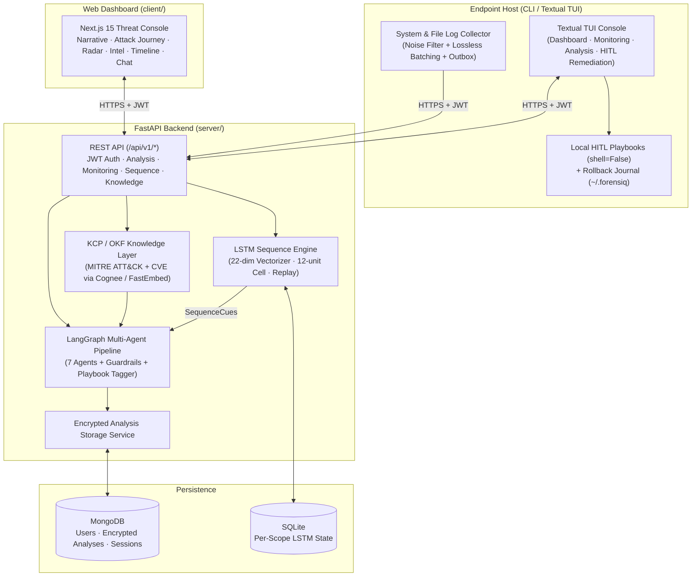

<div align="center">

# ForensIQ

**Evidence-Grounded Multi-Agent Threat Investigation, Cross-Batch LSTM Sequence Modeling & Human-in-the-Loop Remediation**

[](LICENSE)
[](https://www.python.org/)
[](https://fastapi.tiangolo.com/)
[](https://nextjs.org/)
[](https://www.langchain.com/langgraph)
[](https://textual.textualize.io/)

[Features](#-core-capabilities) · [Architecture](#-architecture) · [Quick Start](#-quick-start) · [CLI & TUI](#-cli--tui-usage) · [API](#-api-overview) · [Documentation](#-documentation) · [Contributing](#-contributing)

</div>

---

## Overview

**ForensIQ** is an open-source, end-to-end security operations and forensic log-analysis platform. Instead of treating each log batch in isolation or letting an LLM hallucinate unverified alerts, ForensIQ combines:

1. **Deterministic Normalization & Knowledge Grounding (KCP / OKF)** — Maps raw system logs against MITRE ATT&CK and CVE records with full provenance.
2. **Stateful Cross-Batch LSTM Sequence Engine** — Tracks per-scope hidden/cell state across separate log batches in SQLite to surface slow, multi-stage attack chains.
3. **LangGraph Multi-Agent Investigation Pipeline** — Coordinates specialized agents (Event Analyst, Knowledge Enricher, Sequence Reviewer, Correlation & Timeline, Attack Path Builder, Recommendation Drafter) with strict guardrails separating *observed log facts* from *inferred hypotheses*.
4. **Human-in-the-Loop (HITL) Local TUI Remediation** — Lets analysts preview (`shell=False` command / unified diff), approve, reject, or roll back local system fixes directly from the terminal console, syncing every outcome back to encrypted storage and the web dashboard.

---

## Core Capabilities

- **Multi-Agent Threat Investigation (`LangGraph` + `Gemini`)**
  - Orchestrates 7 specialized agents with bounded refinement loops and deterministic guardrails.
  - Supports single-key, comma-separated key pool (`INVESTIGATION_GEMINI_API_KEYS`), or dedicated per-agent API keys (`INVESTIGATION_GEMINI_API_KEY_*`).
  - Produces structured findings, IOCs, attack-path hypotheses (`OBSERVED` / `INFERRED` / `UNCONFIRMED`), timelines, uncertainty/gaps, and an agent audit trail.
- **Cross-Batch LSTM Sequence Engine**
  - Pure-Python single-layer LSTM cell (`22 -> 12 -> 1`) trained via NumPy BPTT + Adam (`server/services/sequence/artifacts/lstm_v1_0.json`).
  - Persists per-scope `(hidden, cell)` state and a bounded 32-event auditable window in SQLite with out-of-order late-event replay, deduplication, and TTL expiry.
- **Knowledge Compression Pipeline (KCP) & OKF Store**
  - Structured ingestion and semantic retrieval over MITRE Enterprise ATT&CK and CVE JSON feeds via Cognee / FastEmbed.
  - Retrieved knowledge is treated strictly as investigation context, never as standalone proof of compromise.
- **Interactive Threat Visualization Dashboard (`Next.js 15` + `Recharts`)**
  - Calibrated risk & sophistication radar, kill-chain progression, attack-path hypothesis graph, multi-agent `INVESTIGATION_INTEL` explorer, event timeline, executive PDF export, and conversational analysis chat.
- **Endpoint CLI & Textual TUI Agent (`forensiq`)**
  - Continuous file or OS-native system-log monitoring with durable outbox delivery, client-side benign-noise filtering, configurable batch size & split-batch pacing.
  - Built-in **HITL Remediation Queue** supporting 8 parameterized `shell=False` local playbooks (`block_ip`, `lock_user`, `terminate_user_sessions`, `kill_process`, `fix_file_permissions`, `harden_sshd_config`, `quarantine_cron_file`, `upgrade_package`) with atomic rollback journaling (`~/.forensiq/remediation_journal.json`).
- **Encrypted-at-Rest Analysis Storage**
  - User analysis histories, techniques, and multi-agent investigation payloads are encrypted per user before persistence in MongoDB.

---

## Architecture



---

## Repository Structure

```text
forensiq/
├── server/                     # FastAPI backend, LangGraph agents, LSTM engine, KCP/OKF
│   ├── contracts/              # Shared Pydantic event/cue/investigation contracts
│   ├── core/                   # Logging, security, settings
│   ├── db/                     # Async MongoDB (Motor) connection
│   ├── model/                  # Request/response schemas
│   ├── routers/                # auth, analysis, investigations, knowledge, monitoring, sequence
│   ├── services/
│   │   ├── investigation/      # LangGraph workflow, 7 agents, guardrails, playbook tagger
│   │   ├── knowledge/          # KCP ingestion, OKF models, Cognee/FastEmbed retrieval
│   │   ├── sequence/           # LSTM scorer, 22-dim vectorizer, BPTT trainer, SQLite store
│   │   └── visualization_metrics.py
│   └── tests/                  # Pytest suites (investigation, knowledge, sequence)
├── client/                     # Next.js 15 + React 19 + Tailwind CSS v4 + Recharts dashboard
│   ├── app/                    # Auth, Dashboard, Analysis, Visualization, History, Knowledge
│   ├── components/             # Threat dashboard, narrative engine, investigation panel, chat
│   └── lib/                    # Typed API client and domain types
├── cli_agent/                  # Standalone Python CLI & Textual TUI endpoint agent
│   ├── remediation/            # 8 shell=False playbooks, validators, engine, rollback journal
│   ├── services/               # Auth, collector, outbox, monitoring, noise filter & batching
│   ├── tui/                    # 7-page Textual console + HITL confirmation/rollback modals
│   └── tests/                  # Unit & TUI integration tests
└── docs/                       # Architecture, LSTM, KCP/OKF, HITL & Frontend Analyst guides
```

---

## Quick Start

### Prerequisites

- **Python 3.11+** (recommended: [`uv`](https://docs.astral.sh/uv/))
- **Node.js 20+** and **npm**
- **MongoDB** (local instance or MongoDB Atlas URI)
- **Google Gemini API Key** (`GEMINI_API_KEY`)

### 1. Clone the Repository

```bash
git clone https://github.com/Vaibhav2154/forensiq.git
cd forensiq
```

### 2. Start the Backend Server (`server/`)

```bash
cd server
cp .env.example .env
# Edit .env and set GEMINI_API_KEY, MongoDB URI, JWT secret, etc.

uv sync --extra dev
uv run uvicorn main:app --host 0.0.0.0 --port 8000 --reload
```

Verify the server and LSTM engine are live:

```bash
curl -s http://127.0.0.1:8000/api/v1/sequence/status
```

### 3. Start the Web Dashboard (`client/`)

```bash
cd client
npm install
# Optional: configure backend URL in client/.env
echo "NEXT_PUBLIC_API_BASE_URL=http://127.0.0.1:8000" > .env

npm run dev
```

Open [http://localhost:3000](http://localhost:3000) in your browser.

### 4. Install & Run the CLI / TUI Agent (`cli_agent/`)

```bash
cd cli_agent
uv sync
uv run forensiq auth login --username <your-username> --api-url http://127.0.0.1:8000
uv run forensiq tui
```

---

## Configuration

### Backend (`server/.env`)

| Variable | Default | Description |
| :--- | :--- | :--- |
| `HOST` / `PORT` | `0.0.0.0` / `8000` | FastAPI bind host and port. |
| `GEMINI_API_KEY` | — | Primary Google Gemini API key. |
| `INVESTIGATION_GEMINI_API_KEYS` | *(optional)* | Comma-separated pool of Gemini keys distributed across investigation sub-agents. |
| `INVESTIGATION_GEMINI_API_KEY_<AGENT>` | *(optional)* | Per-agent key overrides (`ORCHESTRATOR`, `EVENT_ANALYST`, `KNOWLEDGE_ENRICHER`, `SEQUENCE_ANALYST`, `CORRELATION_TIMELINE`, `ATTACK_PATH`, `RECOMMENDATION`). |
| `INVESTIGATION_GEMINI_MODEL` | `gemini-2.5-flash` | Gemini model used by investigation agents. |
| `INVESTIGATION_MAX_REFINEMENT_ROUNDS` | `1` | Max orchestrator refinement iterations. |
| `SEQUENCE_MODEL_VERSION` | `lstm-sequence-v1.0` | LSTM artifact & state partition version. |
| `SEQUENCE_WINDOW_EVENTS` | `32` | Max normalized events retained per scope window. |
| `SEQUENCE_THRESHOLD` | `0.70` | Risk threshold in `[0.0, 1.0]` for emitting a `SequenceCue`. |
| `SEQUENCE_STATE_TTL_SECONDS` | `3600.0` | Inactivity TTL before a scope's LSTM state expires. |
| `SEQUENCE_STORE_BACKEND` | `sqlite` | Persistence backend (`sqlite` or `memory`). |

### Frontend (`client/.env`)

| Variable | Default | Description |
| :--- | :--- | :--- |
| `NEXT_PUBLIC_API_BASE_URL` | `http://127.0.0.1:8000` | Base URL for the ForensIQ FastAPI server. |

---

## CLI & TUI Usage

### Command-Line Interface

```bash
# Authenticate
forensiq auth register --username analyst --email analyst@example.com
forensiq auth login --username analyst --api-url http://127.0.0.1:8000

# Configure dynamic OS log monitoring (with batch char cap, pacing delay & noise filter)
forensiq profile setup-dynamic \
  --interval 300 \
  --max-batch-chars 10000 \
  --batch-delay 2.0

# Start headless monitoring (add --no-noise-filter to disable client-side filtering)
forensiq monitor --dynamic

# Analyze a single log file
forensiq analyze --file /var/log/auth.log

# Launch the interactive Textual TUI
forensiq tui
```

### Textual TUI Console (`forensiq tui`)

| Key | Action |
| :---: | :--- |
| `1` – `6` | Switch between **Dashboard**, **Monitoring**, **Analysis**, **Knowledge**, **Sessions**, and **Settings**. |
| `7` | Open **Remediation** (HITL local fix queue & rollback journal). |
| `s` / `x` | Start / Stop background monitoring loop. |
| `d` | **Dry-Run / Preview** selected HITL playbook (pre-flight check + exact `shell=False` command / diff). |
| `a` | **Approve & Execute** selected HITL fix (explicit confirmation modal; sudo password kept in memory only). |
| `r` | **Reject** recommendation with an optional analyst note. |
| `u` | **Undo / Rollback** an executed fix from `~/.forensiq/remediation_journal.json`. |

---

## API Overview

Interactive OpenAPI docs are available at `http://127.0.0.1:8000/docs` when the backend is running.

| Group | Key Endpoints |
| :--- | :--- |
| **Auth** | `POST /api/v1/auth/register`, `POST /api/v1/auth/login`, `GET /api/v1/auth/me` |
| **Analysis** | `POST /api/v1/analyze`, `GET /api/v1/latest`, `GET /api/v1/history`, `GET /api/v1/history/{id}`, `POST /api/v1/history/{id}/chat`, `POST /api/v1/history/{id}/remediation-status` |
| **Investigations** | `POST /api/v1/investigations/run`, `POST /api/v1/investigations/batch`, `POST /api/v1/investigations/{id}/remediation-status` |
| **Sequence (LSTM)** | `GET /api/v1/sequence/status`, `POST /api/v1/sequence/evaluate`, `GET /api/v1/sequence/scopes/{scope_key}`, `POST /api/v1/sequence/expire` |
| **Knowledge (OKF)** | `GET /api/v1/knowledge/stats`, `POST /api/v1/knowledge/search`, `POST /api/v1/knowledge/ingest/*` |
| **Monitoring** | `POST /api/v1/monitoring/sessions`, `POST /api/v1/monitoring/sessions/{id}/stop`, `GET /api/v1/analysis/stats` |

---

## Testing

```bash
# Backend: Investigation, Knowledge & Sequence (LSTM) test suites
cd server
uv run pytest tests/ -v

# Retrain the LSTM artifact (optional)
uv run python -m services.sequence.trainer

# CLI & TUI Agent tests
cd ..
PYTHONPATH=. uv run --python cli_agent/.venv/bin/python \
  --with pytest --with pytest-asyncio \
  pytest cli_agent/tests/ --ignore=cli_agent/tests/integration -q

# Frontend TypeScript check & lint
cd client
npx tsc --noEmit
npm run lint
```

---

## Documentation

In-depth design and operational guides live in [`docs/`](docs/):

- [ForensIQ Architecture Evolution](docs/ForensIQ_Architecture_Evolution.md)
- [Multi-Agent Investigation](docs/Multi_Agent_Investigation.md)
- [LSTM Sequence Engine (Implementation Guide)](docs/LSTM_Sequence_Engine.md)
- [Sequential Log Context Model (Design Spec)](docs/Sequential_Log_Context_Model.md)
- [Knowledge Pipeline & OKF](docs/Knowledge_Pipeline_and_OKF.md)
- [Knowledge Compression Pipeline Design](docs/Knowledge_Compression_Pipeline_Design.md)
- [HITL TUI Remediation Design](docs/HITL_TUI_Remediation_Design.md)
- [Frontend Analyst Guide](docs/Frontend_Analyst_Guide.md)

---

## Security & Responsible Use

- **No Autonomous Remediation**: ForensIQ never modifies host state automatically. Every local playbook requires explicit human confirmation in the TUI and executes with `shell=False` against validated parameters.
- **Evidence Provenance**: Retrieved MITRE ATT&CK/CVE entries and LSTM cues are surfaced as investigative context and prioritization signals—not proof of compromise.
- **Secrets**: Never commit `.env` files, API keys, or local session tokens.

---

## Contributing

Contributions are welcome!

1. Fork the repository and create a feature branch (`git checkout -b feat/your-feature`).
2. Follow existing code conventions and add unit tests for new behavior.
3. Verify relevant `pytest` and `tsc --noEmit` checks pass.
4. Open a Pull Request describing your changes and verification steps.

---

## License

Distributed under the **MIT License**. See [LICENSE](LICENSE) for details.
