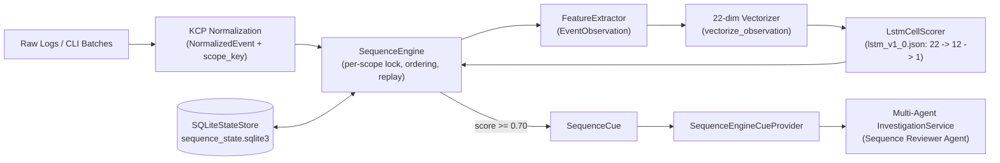

# ForensIQ LSTM Sequence Engine

> **Status:** Implemented & wired live into `server/main.py` and `InvestigationService`.  
> **Original Design Spec:** [Sequential_Log_Context_Model.md](Sequential_Log_Context_Model.md)

---

## 1. Purpose & Role in ForensIQ

Multi-stage cyberattacks frequently span **multiple log batches** (for example, failed SSH logins in Batch 1, a successful login in Batch 2, and `sudo cat /etc/shadow` in Batch 3). Evaluated in isolation, each batch may appear low-risk or ambiguous.

ForensIQ's **LSTM Sequence Engine** (`server/services/sequence/`) maintains **bounded, per-scope sequential memory** across log batches so that cross-batch attack progressions surface as prioritization signals (`SequenceCue`) for the multi-agent investigation workflow.

**Key Design Principle:**
- The LSTM emits a **prioritization cue** (`risk_score`, `window_ref`, `evidence_references`, `model_version`), **not** a final incident verdict or automatic remediation authority.
- Downstream investigation agents (Log Analyst, Sequence Reviewer, Knowledge Retriever, Attack Path Builder, Report Synthesizer) inspect the retained evidence window before forming findings.

---

## 2. End-to-End Architecture



### Core Modules (`server/services/sequence/`)

| Module | Responsibility |
| :--- | :--- |
| `config.py` | `SequenceConfig` (strict validation) and `SequenceSettings` (`SEQUENCE_*` env vars). |
| `features.py` | `FeatureExtractor` converting `NormalizedEvent` + bounded window history into named `EventObservation` records (no raw PII/identifiers leaked into features). |
| `vectorizer.py` | `vectorize_observation()` mapping `EventObservation` into a fixed-width **22-element float vector**. |
| `scoring.py` | `SequenceScorer` protocol, `LstmState` `(hidden, cell)`, and dependency-free pure-Python `LstmCellScorer`. |
| `engine.py` | `SequenceEngine` — groups batches by `scope_key`, orders by event time, handles duplicates, late-event replay, TTL expiry, model-version resets, and `SequenceCue` emission. |
| `window.py` & `replay.py` | Bounded event window trimming (`window_events = 32`) and chronological replay when out-of-order/late events arrive. |
| `state.py` & `sqlite_store.py` | `ScopeState` serialization (`hidden`, `cell`, `entries`, `anchor_state`, `last_event_time`) persisted durably in SQLite (or `InMemoryStateStore` for tests). |
| `cues.py` | Builds contract-compliant `SequenceCue` payloads with `window_ref` and `evidence_references`. |
| `trainer.py` | Deterministic **NumPy BPTT + Adam** trainer generating `artifacts/lstm_v1_0.json`. |
| `provider.py` | `load_lstm_scorer()`, `build_default_sequence_engine()`, and async `SequenceEngineCueProvider` adapter for `InvestigationService`. |
| `server/routers/sequence.py` | FastAPI endpoints under `/api/v1/sequence/*`. |

---

## 3. Input Representation: 22-Dimensional Feature Vector

Every `NormalizedEvent` is first converted to an `EventObservation` (`features.py`) and then encoded into a bounded 22-float vector (`vectorizer.py`, `VECTOR_SIZE = 22`):

| Indices | Count | Feature Group | Encoding |
| :--- | :---: | :--- | :--- |
| `0..7` | 8 | **Event Type** (one-hot + unknown) | `authentication_failure`, `authentication_success`, `privilege_escalation`, `security_alert`, `network_connection_error`, `application_error`, `application_warning`, `other` |
| `8..10` | 3 | **Outcome** (multi-hot) | failure (`failure`/`failed`/`denied`/`rejected`/`error`), success (`success`/`accepted`/`ok`), executed (`executed`/`completed`/`started`) |
| `11` | 1 | **Normalized Severity** | Numeric severity scaled to `[0, 1]`, or mapped from label (`critical: 1.0`, `alert: 0.9`, `error: 0.75`, `warn: 0.5`, `info: 0.25`, `debug: 0.1`) |
| `12` | 1 | **Log-Scaled Time Delta** | $\min\left(\frac{\ln(1 + \Delta t)}{\ln(1 + 3600)}, 1.0\right)$ since previous event in the same scope |
| `13` | 1 | **Burst Flag** | `1.0` if $\Delta t \le 300\text{s}$ (5 minutes), else `0.0` |
| `14` | 1 | **Window Event Count** | $\min(\text{window\_event\_count} / 10.0, 1.0)$ |
| `15` | 1 | **Same-Type Window Occurrences** | $\min(\text{event\_type\_occurrences\_in\_window} / 5.0, 1.0)$ |
| `16` | 1 | **First Occurrence Flag** | `1.0` if first time this `event_type` appears in the current window |
| `17..21` | 5 | **Context Presence Flags** | Binary presence (`1.0`/`0.0`) for `host`, `account`, `process`, `service`, `remote_ip` |

Raw hostnames, usernames, IPs, and log text stay attached as `EvidenceReference` links in the window for auditability — they are never fed as unbounded vocabulary into the LSTM.

---

## 4. Model Architecture & Recurrence

`LstmCellScorer` (`scoring.py`) runs a **single-layer LSTM cell** with zero third-party runtime dependencies (pure Python `math.exp` / `math.tanh`):

- **Input size (`D`):** `22`
- **Hidden / Cell size (`H`):** `12`
- **Output:** Scalar risk score $y_t \in [0, 1]$ via a linear readout + sigmoid

At each timestep $t$ with input $x_t \in \mathbb{R}^{22}$ and prior scope state $(h_{t-1}, c_{t-1}) \in \mathbb{R}^{12} \times \mathbb{R}^{12}$:

$$
\begin{aligned}
i_t &= \sigma(W_i x_t + U_i h_{t-1} + b_i) \\
f_t &= \sigma(W_f x_t + U_f h_{t-1} + b_f) \\
o_t &= \sigma(W_o x_t + U_o h_{t-1} + b_o) \\
g_t &= \tanh(W_g x_t + U_g h_{t-1} + b_g) \\
c_t &= f_t \odot c_{t-1} + i_t \odot g_t \\
h_t &= o_t \odot \tanh(c_t) \\
\text{score}_t &= \sigma(w_{\text{out}}^\top h_t + b_{\text{out}})
\end{aligned}
$$

- If $\text{score}_t \ge \text{threshold}$ (default **`0.70`**), `SequenceEngine` emits a `SequenceCue` carrying `scope_key`, `risk_score`, `threshold`, `model_version`, `window_ref`, and `evidence_references`.

---

## 5. Training Pipeline & Model Artifact

Weights are trained offline using **Backpropagation Through Time (BPTT) with Adam** in `server/services/sequence/trainer.py` and exported to `server/services/sequence/artifacts/lstm_v1_0.json`.

### Current Artifact (`lstm_v1_0.json`)

| Property | Value |
| :--- | :--- |
| `model_version` | `lstm-sequence-v1.0` |
| `architecture` | `single_layer_lstm` |
| `input_size` / `hidden_size` | `22` / `12` |
| `threshold` | `0.70` |
| Training sequences / active timesteps | `133` sequences / `385` timesteps |
| Optimizer | Adam (`epochs=450`, `lr=0.02`, `weight_decay=5e-5`, `seed=42`) |
| Final average BCE loss | `0.000523` |

### Retraining the Artifact

```bash
cd server
.venv/bin/python -m services.sequence.trainer
```

---

## 6. Per-Scope State Lifecycle & Safeguards

To prevent cross-host contamination and stale drift, `SequenceEngine` enforces strict per-scope isolation and safeguards:

1. **Per-Scope Isolation**: Events are grouped by `scope_key` (e.g., `host:prod-web-01|account:deploy`). Unrelated hosts/accounts never share hidden or cell state.
2. **Cross-Batch Continuity**: A batch boundary never resets `(h, c)`. Processing Batch $N+1$ resumes directly from the persisted state after Batch $N$.
3. **Bounded Auditable Window**: Each scope keeps at most `window_events` (default `32`) `WindowEntry` records alongside `(h, c)` and an `anchor_state` (the LSTM state right before the oldest retained entry).
4. **Late / Out-of-Order Replay**:
   - If a late event arrives with a timestamp earlier than the latest event in the window, `SequenceEngine` rebuilds the window from `anchor_state` in chronological `(event_time, event_id)` order.
   - If the event is older than the earliest retained entry *and* the window has already been trimmed (`state.trimmed == True`), the event is **skipped** and recorded in `skipped_event_ids` / `replay_incomplete_scope_keys` rather than corrupting state.
5. **Deduplication**: Duplicate `event_id`s already in the window are skipped and reported in `duplicate_event_ids`.
6. **TTL Expiry**: Scopes inactive longer than `state_ttl_seconds` (default `3600s` / 1 hour) expire and reset cleanly (`reset_reason = "ttl-expired"`).
7. **Model-Version & Corruption Resets**: If `state.model_version != config.model_version` or a persisted SQLite row fails validation (`StateCorruptionError`), the scope is safely reset (`model-version-change` / `corrupted-state`).
8. **Durable Persistence**: `SQLiteStateStore` stores serialized scope state atomically in `server/.forensiq_sequence/sequence_state.sqlite3` (survives backend restarts).

---

## 7. Integration with Multi-Agent Investigation & API

### Backend Wiring (`server/main.py`)
On FastAPI startup, the server builds the default `SequenceEngine` from `SequenceSettings`, loads `lstm_v1_0.json`, injects it into `routers.sequence.set_sequence_engine(engine)`, and attaches `SequenceEngineCueProvider(engine)` to `InvestigationService`.

When `/api/v1/analyze` or `/api/v1/investigations/batch` runs:
1. Normalized events are passed to `SequenceEngineCueProvider.get_cues(events)`.
2. Any emitted `SequenceCue`s are passed to the **Sequence Reviewer Agent** in the LangGraph investigation workflow.
3. The investigation response includes `sequence_assessment` (and the Web UI displays it under **Visualization → `INVESTIGATION_INTEL` → `SEQUENCE_LSTM`**).

### REST API Endpoints (`server/routers/sequence.py`)

| Method | Endpoint | Description |
| :--- | :--- | :--- |
| `GET` | `/api/v1/sequence/status` | Returns `lstm_ready`, `model_version`, `window_events`, `threshold`, `state_ttl_seconds`, `store_backend`, and `active_scopes_count`. |
| `POST` | `/api/v1/sequence/evaluate` | Evaluates a batch of `NormalizedEvent` objects and returns `cues`, `processed_event_ids`, `skipped_event_ids`, `duplicate_event_ids`, and scope lifecycle lists. |
| `GET` | `/api/v1/sequence/scopes/{scope_key}` | Inspects the retained window metadata (`window_size`, `event_ids`, `latest_score`, `trimmed`, `replay_incomplete`, `evidence_references`). |
| `POST` | `/api/v1/sequence/expire` | Sweeps and deletes all scopes inactive past `state_ttl_seconds`. |

---

## 8. Configuration Environment Variables

Configured via `SequenceSettings` (`env_prefix="SEQUENCE_"` in `server/services/sequence/config.py`):

| Variable | Default | Description |
| :--- | :--- | :--- |
| `SEQUENCE_MODEL_VERSION` | `lstm-sequence-v1.0` | Partition key & version tag written into every `SequenceCue`. |
| `SEQUENCE_WINDOW_EVENTS` | `32` | Maximum normalized events retained per scope window. |
| `SEQUENCE_THRESHOLD` | `0.70` | Risk score threshold in `[0.0, 1.0]` for emitting a `SequenceCue`. |
| `SEQUENCE_STATE_TTL_SECONDS` | `3600.0` | Inactivity TTL (seconds) before a scope's state expires. |
| `SEQUENCE_STORE_BACKEND` | `sqlite` | Persistence backend: `sqlite` or `memory`. |
| `SEQUENCE_STATE_DB_PATH` | `server/.forensiq_sequence/sequence_state.sqlite3` | SQLite file path for durable per-scope state. |
| `SEQUENCE_ARTIFACT_PATH` | `server/services/sequence/artifacts/lstm_v1_0.json` | Path to the trained LSTM weights JSON artifact. |

---

## 9. Verification & Testing

Run the full sequence unit & integration test suite:

```bash
cd server
.venv/bin/python -m pytest tests/sequence/ -v
```

Check live engine health while the server is running:

```bash
curl -s http://127.0.0.1:8000/api/v1/sequence/status
```

